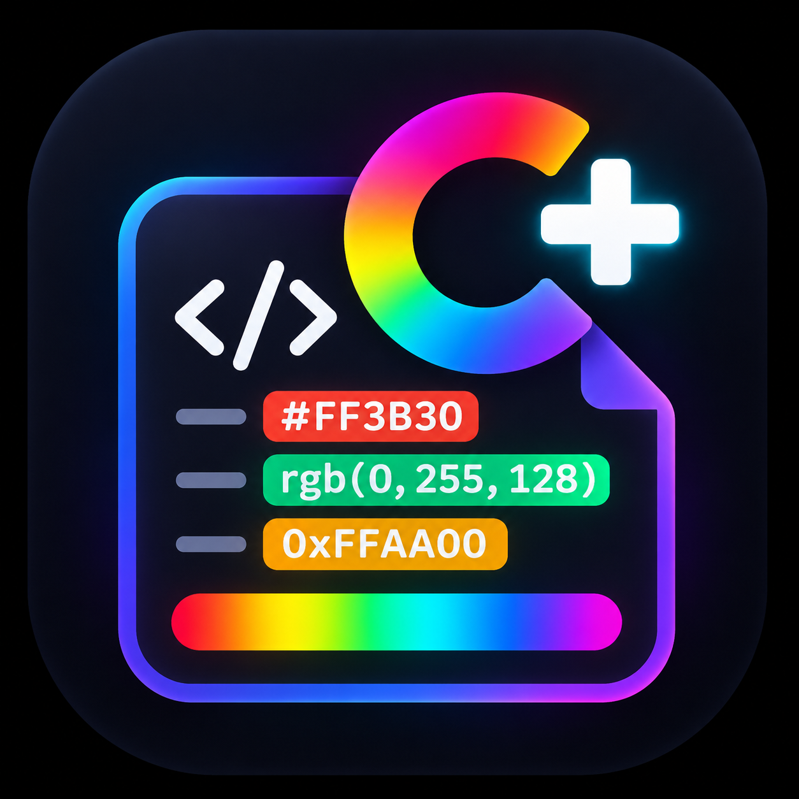

<p align="center">
  
</p>

# Colorize Plus

**Author:** Noums

Colorize Plus keeps the original **Colorize** settings and behavior while adding first-class Lua and FiveM support. Existing Colorize workspaces can keep their familiar configuration, and the Lua/FiveM additions remain enabled independently.

## Restored Colorize features

- CSS color names (the complete browser color set), hexadecimal colors with `#` or `0x`, RGB/RGBA, HSL/HSLA, ARGB, OKLAB and OKLCH.
- Legacy `colorize.include` and `colorize.exclude` glob filtering, alongside the existing `colorize.files` and `colorize.files_extensions` compatibility settings.
- Decoration styles: `background`, `underline`, `outline`, `dot` and `square-dot`.
- Optional color marks in the overview ruler / scrollbar with `colorize.ruler_decoration`.
- CSS, Sass, Less and Stylus variable references.
- Optional workspace-wide variable discovery with `colorize.enable_search_variables`, so a variable declared in one matching file can colorize references in another.
- The active-line hiding behavior and Colorize status-bar indicator.

## Lua & FiveM additions

- Lua hexadecimal integers such as `0xFF8800`.
- Color-assigned Lua tables such as `color = { 255, 136, 0, 200 }`.
- Named RGB/RGBA channels, including `color = { r = 0, g = 170, b = 255, a = 150 }`. Channel order, multiline tables, trailing separators and bracket keys such as `["r"]` are supported. Alpha accepts 0–1 or byte values above 1 up to 255.
- Keyed RGB/RGBA palette entries inside color tables, for example `CategoryColors = { Staff = { 125, 0, 125 }, ["Météo"] = { 56, 189, 248 } }`.
- FiveM caret formatting codes (`^1` … `^9`).
- FiveM HUD formatting codes such as `~r~`, `~g~`, `~b~`, `~y~` and `~w~`.

Lua table matching recognizes direct color-like assignments and keyed RGB/RGBA entries nested inside tables whose name contains `color`, `colour` or `palette`. Ordinary coordinate tables such as `coords = { 255, 64, 0 }` remain ignored.

In Lua files, `#` is treated as the length operator outside strings and comments. Expressions such as `#definition.Sections`, `#def` and `#dead` are never highlighted as colors; quoted hexadecimal colors still work.

FiveM codes in Lua are recognized only inside quoted or long-bracket strings. Expressions such as `(p.x - destination.X)^2` use Lua's power operator and are not decorated. FiveM codes in Lua comments are also ignored.

## Install and update in VS Code

Download the `.vsix` from the [latest GitHub release](https://github.com/Noums75/colorize-plus/releases/latest). In VS Code, run **Extensions: Install from VSIX…** and select the file. Reload VS Code after installation. Versions before 2.1.5 may require this manual installation on recent VS Code versions to acquire the corrected updater.

Colorize Plus checks stable GitHub releases **on every launch**, about three seconds after VS Code finishes starting. A check earlier the same day never suppresses the startup check. It then checks **every hour** by default while the window remains open. When a newer version exists, it downloads the VSIX, verifies its SHA-256 checksum and installs it. A notification lets you reload VS Code when convenient; the extension never reloads your editor automatically. Public releases need no Marketplace account or GitHub token.

Run **Colorize Plus: Check for updates** for an immediate check and installation with visible progress. Run **Colorize Plus: Show update log** to see checks, installed versions, errors and scheduled retries. The log does not include credentials.

These **User** settings control checking and installation independently and apply immediately:

```json
{
  "colorize.updates.checkOnStartup": true,
  "colorize.updates.checkIntervalHours": 1,
  "colorize.updates.autoUpdate": true
}
```

- Set `colorize.updates.autoUpdate` to `false` to keep checks enabled and receive an **Install update** action instead of automatic installation. Each available version is announced once. The manual check command can still install it.
- Change `colorize.updates.checkIntervalHours` to 3, 6, 12 or 24 for less frequent checks, or 0 to turn off periodic checks.
- Set `colorize.updates.checkOnStartup` to `false` and the interval to 0 to disable all automatic checks. Manual checks remain available.

**Private repositories:** use an account that can read `Noums75/colorize-plus`; VS Code requests the `repo` scope required for private releases. Existing GitHub sessions are reused silently. If access is missing, an occasional **Sign in** notification lets you authorize it; background checks never open interactive sign-in themselves. You can also run **Colorize Plus: Check for updates** to sign in or renew an expired session. Tokens stay with VS Code's authentication provider and are sent only to `api.github.com`, never saved in Colorize settings or logs. You also need repository access in your browser for the initial download.

Offline checks and failed downloads or installations leave your installed version working. Automatic failures retry after 1, 5 and 15 minutes, then hourly until recovery. GitHub rate-limit delays take precedence, including after a restart; a manual command cannot bypass a server-imposed wait. Manual checks report failures and offer the log. Requests are cancelled when the extension stops, and concurrent windows use separate temporary download directories. Access to `api.github.com`, `github.com` and GitHub's release download hosts is required; a restrictive corporate proxy may require using the manual VSIX download instead.

### Quick terminal installer (Windows, macOS, Linux)

Install Node.js 22+ and make the `code` command available on PATH (on macOS: **Shell Command: Install 'code' command in PATH**). Download `install-colorize.cjs` from the latest release and run:

```sh
node install-colorize.cjs
```

The standalone installer downloads the latest stable VSIX, verifies `SHA256SUMS`, installs it using `code --install-extension --force`, and removes its temporary files. Run the same command later for a manual update. It needs no npm packages or repository clone. It targets VS Code Stable in your current command-line environment; for another editor or profile, install the VSIX there manually.

For a private repository, also install [GitHub CLI](https://cli.github.com/) and run `gh auth login` with an account that can read the repository before running the installer. The installer delegates authenticated API requests to `gh` without extracting its token.

## Settings

```jsonc
{
  "colorize.languages": ["css", "sass", "scss", "less", "stylus", "lua"],
  "colorize.include": ["**/*.css", "**/*.scss", "**/*.sass", "**/*.less", "**/*.styl"],
  "colorize.exclude": ["**/node_modules", "**/dist", "**/tests"],
  "colorize.files": ["**/*.js", "**/*.html", "**/*.lua"],
  "colorize.colorized_colors": [
    "BROWSERS_COLORS", "HEXA", "RGB", "HSL", "OKLAB", "OKLCH", "LUA", "FIVEM"
  ],
  "colorize.colorized_variables": ["CSS", "SASS", "LESS", "STYLUS"],
  "colorize.enable_search_variables": false,
  "colorize.decoration_type": "background",
  "colorize.ruler_decoration": true,
  "colorize.hide_current_line_decorations": false,
  "colorize.lua.enableTables": true,
  "colorize.lua.enableFiveM": true
}
```

`ARGB` is available in `colorize.colorized_colors` but is not enabled by default because 4/8-digit hexadecimal values are ambiguous between RGBA and ARGB. Put `ARGB` before `HEXA` in the array when ARGB interpretation should win.

Workspace variable discovery is intentionally disabled by default in Colorize Plus to avoid an unnecessary startup scan. Turn on `colorize.enable_search_variables` when you need references to declarations from other files.

Run **Colorize Plus: Reload decorations** from the command palette (or click the Colorize Plus status-bar item) after changing files externally. Configuration and document edits refresh automatically.

## Development

```sh
npm ci
npm test
npm run check
npm run build
```

Development and packaging require Node.js 22 or newer. GitHub Actions runs the tests and builds the VSIX on every push and pull request.

For a new stable release, update `version` in `package.json` and `package-lock.json`, then push to `main`. After tests and packaging pass, GitHub Actions creates `vX.Y.Z` with the VSIX, the standalone installer and `SHA256SUMS`. Minor and patch releases are supported, and existing releases are left unchanged. The workflow can also be run manually on `main` to retry a failed release.

Press `F5` in VS Code to launch an Extension Development Host.
